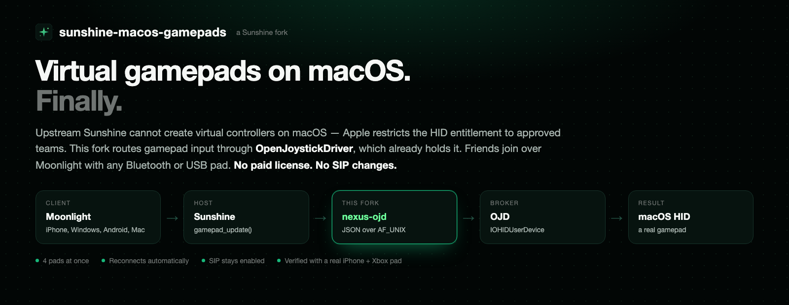

<div align="center">

# Sunshine — virtual gamepads on macOS

**The Sunshine fork that makes controllers work on a Mac host: friends join over Moonlight with any
Bluetooth or USB pad, and the game sees a real HID gamepad — no paid license, no SIP changes.**


[**Setup**](#setup) · [**How it works**](#how-it-works) · [**What works**](#what-works) ·
[**Building**](#building-from-source) · [**Troubleshooting**](#troubleshooting) · [**Why not SIP**](#why-not-just-disable-sip)



</div>

> [!NOTE]
> This is a fork of [LizardByte/Sunshine](https://github.com/LizardByte/Sunshine), the self-hosted game stream
> host for Moonlight. Upstream does the hard part: capture, encode, transport, input parsing and the whole Moonlight
> protocol. This fork adds one thing — a macOS gamepad backend — and touches nine files to do it. It is meant to go
> upstream once the dependency question is settled.

> [!IMPORTANT]
> **Upstream says gamepads do not work on macOS, and that is accurate.** The [feature
> matrix](https://docs.lizardbyte.dev/projects/sunshine/latest/) lists every emulated controller as unsupported on
> macOS. This fork changes that, but it depends on a third-party app being installed and configured. Read
> [Setup](#setup) before expecting controllers to appear.

## The problem

Creating a virtual HID device on macOS requires the entitlement `com.apple.developer.hid.virtual.device`. Apple
grants it per team, through an approval process that is **not** tied to account tier — a free Personal Team cannot
get it, and neither can a paid membership without approval.

| Platform | Gamepad emulation |
|---|---|
| Windows | ✅ paid Virtual HID Broker, or ViGEmBus |
| Linux / FreeBSD | ✅ |
| **macOS** | **❌ not supported upstream** |

The commercial answer is [Virtual HID Broker](https://github.com/LizardByte/libvirtualhid) — roughly $15/year or
$50 lifetime for a signed broker that already holds the entitlement. It works, and if you want the simplest path,
buy it and use stock Sunshine.

This fork is the free route. It found that the entitlement is not the only variable: what matters is *who holds it*.

## How it works

[OpenJoystickDriver](https://github.com/xsyetopz/OpenJoystickDriver) is a separately signed, notarized macOS app
that already holds the entitlement, and it exposes a documented local-socket API. Sunshine does not need to create
HID devices — it needs a program that can. So the fork drives OJD's endpoint instead.

```
Moonlight client (Bluetooth/USB controller)
        │  Moonlight controller packets
        ▼
Sunshine  ── platf::gamepad_update ──▶  nexus-ojd  ──▶  OpenJoystickDriver  ──▶  macOS HID
        │                                    │                 │                      │
        │                          JSON over AF_UNIX    IOHIDUserDevice          a real pad
        ▼
   video stream                                                        ──▶  the game
```

The bridge lives in [`third-party/nexus-ojd`](third-party/nexus-ojd) — 25 files, no third-party dependencies. It
batches Sunshine's input rate down to a bounded publish rate, sends keep-alives so OJD's two-second idle timeout
never fires, and reconnects with backoff if OJD restarts.

## Setup

Requires macOS 14.2+, an Apple silicon or Intel Mac, and a Moonlight client.

### 1. Install OpenJoystickDriver

Download the macOS DMG from the
[latest release](https://github.com/xsyetopz/OpenJoystickDriver/releases), drag **OpenJoystickDriver.app** into
Applications, and open it.

```sh
open /Applications/OpenJoystickDriver.app
# if either permission is still denied:
/Applications/OpenJoystickDriver.app/Contents/MacOS/OpenJoystickDriver permission request
```

Input Monitoring and Accessibility are both required. Without them the virtual pad is created but refuses to start,
reporting `Input Monitoring denied`.

### 2. Enable the endpoint and mint a token

OJD installs no CLI by default; its own binary acts as one when invoked under the name `ojd`.

```sh
ln -sf /Applications/OpenJoystickDriver.app/Contents/MacOS/OpenJoystickDriver /usr/local/bin/ojd

ojd access enable --force
ojd access grant --token sunshine --scope read --scope control
```

The grant prints a token **once**. Copy it. It is a password: anything holding it can drive the virtual pads.

```sh
ojd --json access status | jq -r .socketPath
# /var/folders/.../com.openjoystickdriver.endpoint.sock
```

The socket path lives under `$TMPDIR` and changes when that directory is cleared, so re-read it if pads stop working
after a reboot.

### 3. Configure Sunshine

Either use the Web UI at `https://localhost:47990` → **Configuration → Input**, which now has an
**OpenJoystickDriver gamepads** section, or edit `~/.config/sunshine/sunshine.conf`:

```ini
controller = enabled
gamepad_driver = virtualhid
ojd_socket_path = /var/folders/.../com.openjoystickdriver.endpoint.sock
ojd_token = ojd_...
```

Both values are required. Leave either empty and the backend stays completely inert, so Sunshine behaves exactly as
upstream. Restart Sunshine afterwards.

### 4. Pair and play

Pair your Moonlight client, launch an app, use a controller. That's it.

## What works

Verified on macOS 27.2 (arm64), Sunshine `657f9b6`, with a real iPhone running the App Store Moonlight client and a
Bluetooth Xbox controller:

| | Status |
|---|---|
| Virtual pads from Moonlight clients | ✅ verified end to end |
| Bluetooth and USB controllers | ✅ transport is irrelevant — Moonlight sends packets, not devices |
| Input reaches the game | ✅ confirmed by reading back HID element values |
| Pad visible to the OS | ✅ `Xbox Adaptive Controller · 045e:0b0c` |
| Up to 4 pads simultaneously | ✅ verified 4/4 created, enumerated and torn down |
| Reconnect after OJD restarts | ✅ automatic, backoff 250 ms → 5 s |
| SIP / AMFI | ✅ untouched — `csrutil status` stays `enabled` |
| 4 *concurrent* Moonlight clients | ⚠️ designed for it, not yet exercised |
| Rumble | ⚠️ parsed but deliberately not wired up — see [Limits](#limits) |

## Verify it works

```sh
# While moving a stick in Moonlight, expect:
#   Xbox Adaptive Controller | Microsoft | 045e:0b0c
ojd --json controller list

# Or from Sunshine's log:
grep "OpenJoystickDriver backend" ~/.config/sunshine/sunshine.log
# Info: Gamepad 0 uses the OpenJoystickDriver backend
```

If no pad appears, check that `gamepad_driver` is not `none` — Sunshine's input layer drops controller packets
before any backend is reached in that case.

## Building from source

```sh
brew install cmake ninja boost ffmpeg opus nlohmann-json miniupnpc icu4c

git clone --recursive https://github.com/srikanthamsa/sunshine-macos-gamepads.git
cd sunshine-macos-gamepads

# build-deps must be on a *tagged* commit, or FFmpeg resolves to a release that does not exist.
git -C third-party/build-deps fetch --depth 1 origin tag v2026.1017.131201
git -C third-party/build-deps checkout v2026.1017.131201
git -C third-party/moonlight-common-c submodule update --init --recursive

cmake -S . -B build -G Ninja \
  -DCMAKE_BUILD_TYPE=Release \
  -DSUNSHINE_ENABLE_TRAY=OFF \
  -DCMAKE_EXE_LINKER_FLAGS="-L/opt/homebrew/opt/icu4c@79/lib"

cmake --build build -j8
```

`-DSUNSHINE_ENABLE_TRAY=OFF` avoids Qt. The ICU flag is needed because Boost.Locale statically links it and
Homebrew's `icu4c` is keg-only. The app is `build/Sunshine.app`.

### Component tests

The bridge builds and tests without Sunshine, OJD, or a gamepad:

```sh
cd third-party/nexus-ojd
cmake -S . -B build && cmake --build build
./build/ojd_client_test
```

30 checks: hashing against RFC 6234 / RFC 4231 vectors, JSON rendering, strict reply parsing, button and axis
mapping, and a full handshake against a fake endpoint.

## Differences from upstream

Nine files changed, ~150 lines:

```
third-party/nexus-ojd/                    the OJD endpoint client (25 files, no dependencies)
src/platform/virtualhid_input.cpp         route gamepad calls to OJD when configured
src/input.cpp                             probe_gamepads() recognises the OJD backend
src/config.{h,cpp}                        ojd_socket_path, ojd_token; token redacted in logs
cmake/compile_definitions/macos.cmake     build the component
CMakeLists.txt                            fork version
src_assets/.../Home.vue                   suppress the libvirtualhid warning when OJD is active
src_assets/.../Inputs.vue                 config UI for the two new options
src_assets/.../locale/en.json             strings
```

Upstream's `gamepad_driver` policy, the ViGEmBus path and the libvirtualhid path are untouched. Without OJD
configured, behaviour is identical to upstream.

## Troubleshooting

| Symptom | Cause and fix |
|---|---|
| No pad appears, log says `No gamepad input is available` | `gamepad_driver` is `none`, or `ojd_socket_path`/`ojd_token` are unset. Sunshine drops packets before any backend. |
| `Input Monitoring denied` from OJD | Grant Input Monitoring and Accessibility to `/Applications/VirtualHIDBroker.app` / OpenJoystickDriver in System Settings → Privacy & Security. |
| Pad appears, then vanishes after ~2 s | OJD's feed idle timeout. The bridge sends keep-alives; if it persists, the client stopped sending frames — check the Moonlight connection. |
| Works, then stops after a reboot | The socket path is under `$TMPDIR` and changed. Re-read `ojd --json access status` and update `ojd_socket_path`. |
| Config page saves lose the OJD settings | Fixed in this fork, but on older builds the UI's save rewrites the whole file. Re-add both keys by hand. |
| Rumble does nothing | Not wired up. See below. |
| Pads stop working after rebuilding Sunshine | macOS TCC keys screen-recording grants by bundle ID *plus* signing identity. An ad-hoc rebuild looks like a new app. `tccutil reset ScreenCapture`, then re-grant. |

## Limits

- **Rumble is disabled.** The client parses OJD's `RumbleCommand` correctly, but wiring it into Sunshine is unsafe
  with multiple viewers: Sunshine has one feedback queue per Moonlight session while these pads are process-global,
  so the bridge cannot tell which session owns a pad and would route one player's rumble to another. Fixing it
  needs session identity plumbed through the platform input entry points.
- **Four pads maximum.** OJD serves 4 virtual gamepads per endpoint client. For a 5-player session, one player uses a
  controller attached to the host.
- **No motion, touchpad or battery.** OJD chooses the virtual device profile; Sunshine's controller arrival metadata
  is not forwarded.
- **`SDLCompatible` persona only.** The `Generic` profile's HID descriptor is input-only, so rumble could never work
  there.
- **OJD is pre-release alpha.** Its endpoint `apiVersion` changed once already between alpha releases. All protocol
  strings live in `protocol.hpp` so an upstream bump stays contained.
- **Concurrent clients are unproven.** Four pads work; four simultaneous Moonlight sessions have not been exercised.

## Why not just disable SIP?

Because it does not work, and it is not necessary.

Measured on a real machine: signing a binary with the restricted entitlement and launching it returns `Killed: 9`
from AMFI **even after** `csrutil disable`, because SIP and AMFI are separate layers. Disabling AMFI additionally
requires `amfi_get_out_of_my_way=1`, and on Apple silicon that means downgrading boot policy to Permissive with
`bputil -a` — a permanent, system-wide reduction in security, which the tool itself warns can render a Mac
unbootable.

Re-signing OJD's own app with a different certificate fails the same way: the entitlement is bound to *their* team
ID. There is no path to "just sign it yourself."

Driving OJD's documented endpoint avoids all of it. `csrutil status` stays `enabled` and `boot-args` stays empty.

## Credits

- **[LizardByte/Sunshine](https://github.com/LizardByte/Sunshine)** — the host this forks. GPL-3.0.
- **[xsyetopz/OpenJoystickDriver](https://github.com/xsyetopz/OpenJoystickDriver)** — the notarized virtual-HID
  broker and its endpoint SDK.
- **[moonlight-stream](https://github.com/moonlight-stream)** — the client protocol, and Moonlight for iOS.

Upstream's original README is preserved as [README.upstream.md](README.upstream.md). Component notes for another
engineer: [COLLABORATION.md](third-party/nexus-ojd/COLLABORATION.md) and
[INTEGRATION.md](third-party/nexus-ojd/INTEGRATION.md).

## License

GPL-3.0-or-later, inherited from Sunshine. The `third-party/nexus-ojd` component is distributed under the same terms.

OpenJoystickDriver is licensed separately under
[PolyForm Noncommercial 1.0.0](https://github.com/xsyetopz/OpenJoystickDriver/blob/main/LICENSE). This fork talks to
it over its documented local API and does not include its source. Noncommercial use is covered; commercial use needs
a license from OJD's author.

*Sunshine* is a LizardByte project. This fork is not affiliated with or endorsed by LizardByte. No paid license, no
Apple developer account and no OJD license are distributed here.
